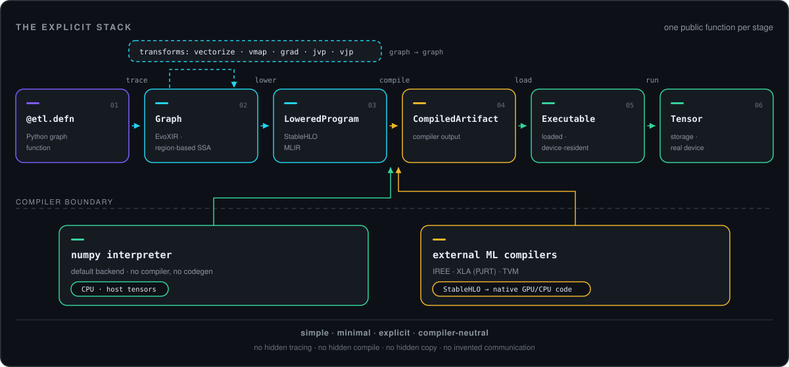

<div align="center">


<h1 align="center">etl</h1>

<p><strong>EvoX Tensor Language</strong> — a minimal, explicit, compiler-neutral tensor graph runtime.</p>

<p>
  <a href="#install"></a>
  <a href="#install"></a>
  <a href="#backends"></a>
  <a href="#status--deferrals"></a>
  <a href="#license"></a>
</p>

<p><a href="#why-etl-exists">Why</a> · <a href="#the-stack-from-a-python-graph-to-an-ml-compiler">The stack</a> · <a href="#quickstart--sixty-seconds">Quickstart</a> · <a href="#features">Features</a> · <a href="#backends">Backends</a> · <a href="#how-etl-compares">vs others</a> · <a href="#install">Install</a></p>
</div>

etl is a Python tensor <em>language</em> whose program is an explicit SSA graph. You build the graph; etl owns the frontend (trace → transform → IR → StableHLO); external ML compilers own the optimization, scheduling, memory planning and code generation. With no compiler installed it still runs — on a reference numpy interpreter.

---

## Why etl exists

A modern numerical framework fuses five different things into one opaque stack: a tensor language, a tracer, a compiler, a scheduler and an allocator. The result is convenient, and the program stops being an object you can hold — it is re-derived on every call, re-specialized when a Python value changes, re-captured when a guard fails, and the compiler quietly owns semantics the author never wrote down: implicit tracing, hidden caches, automatic resharding, eager/graph mode switches.

etl splits that stack along one hard line. Above it is the **frontend**: a tensor language in which the program is an explicit, inspectable, persistable, transformable SSA graph, and every staging step is a public function with a public object for its result. Below it are **external compilers** — IREE, XLA via PJRT, TVM — which receive StableHLO and own how the computation executes. Nothing on the etl side pretends to be a compiler, and nothing below the line may change what the program means.

## Four words

**Minimal** — `numpy` is the only hard dependency; pure Python, no native code, no runtime, no code generator, no kernel library. The default backend interprets the IR with numpy kernels. *So what: no compiler toolchain stands between you and a running graph.*

**Explicit** — every stage is a public function (`trace`, `lower`, `compile`, `load`, `run`) and every object a distinct public type (`Defn`, `Graph`, `LoweredProgram`, `CompiledArtifact`, `Executable`, `Tensor`); convenience APIs are documented shorthand whose exact expansion is in their docstrings. *So what: you can stop at any stage, inspect it, save it, or ship it.*

**Compiler-neutral** — the contract with the backend world is EvoXIR in the frontend and StableHLO MLIR at the boundary. No vendor IR is the definition of the IR; no adapter is privileged. *So what: swapping IREE for XLA or TVM is a `backend=` argument, not a rewrite.*

**Simple** — one obvious way per thing: `vmap` is sugar over `vectorize`, `bind` is argument-passing sugar, `build` is `trace → lower → compile → load`. No eager mode, no second semantics behind a flag. *So what: when the code surprises you, the surprise is in your graph.*

## The stack: from a Python graph to an ML compiler



| stage | public function | resulting object | what it produces | what it never does silently |
|---|---|---|---|---|
| graph function | `@etl.defn` | `Defn` | a Python callable marked as a graph *definition* | run eagerly — calling it on concrete tensors raises `TraceError` |
| trace | `etl.trace(fn, *specs)` | `Graph` | EvoXIR: a region-based SSA module + input/output trees + snapshotted static values | compile, optimize, or turn a symbolic `Dim` into a constant |
| transform | `etl.vectorize` / `vmap` / `grad` / `jvp` / `vjp` | `Graph` | an ordinary graph of ordinary ops | execute, or leave a `vmap`/`grad` op for a backend to interpret |
| lower | `etl.lower(graph, backend=…)` | `LoweredProgram` | StableHLO MLIR text, or the backend's own payload | optimize or compile; an unsupported op is an explicit `BackendError` |
| compile | `etl.compile(lowered, **opts)` | `CompiledArtifact` | the compiler's artifact (vmfb, PJRT executable, serialized program) | get replaced at load — a version/ABI mismatch is a `PersistenceError` |
| load | `etl.load(artifact, device=…)` | `Executable` | a device-bound executable that can be called | move your data onto the device, or recompile for another target |
| run | `etl.run(exe, *args)` | `Tensor` (tree) | outputs in the same pytree shape you passed in | copy results to the host, cast, reshard, or insert communication |

**Two backends below the line.** The default path stops at `lower`: the **numpy interpreter** runs the EvoXIR program directly with numpy kernels — no compiler, no codegen, no artifact. The compiler paths take the *same* StableHLO text: **IREE** (llvm-cpu, cuda, rocm, vulkan-spirv), **XLA** (PJRT C API over a user-provided plugin `.so`) and **TVM** (StableHLO frontend + Relax VM).

**Layer discipline** — a strict one-way import DAG, so every problem has one owner:

```
core  ←  ir  ←  ops  ←  { trace, numpy }  ←  { block, transforms, backends, dist, sparse, pipeline, persist }
```

<sub>`core` imports nothing from etl (numpy only) · `ir` imports `core` · `ops` imports `core`, `ir`, `trace`'s builder hook · `trace` imports `core`, `ir` (never `ops`) · each module to the right imports only what is to its left.</sub>

## Quickstart — sixty seconds

The explicit pipeline; every intermediate is a real object you can keep:

```python
import etl
from etl import TensorSpec

@etl.defn
def f(x, w):
    return etl.sum(etl.tanh(etl.dot(x, w)), axes=1)

spec_x, spec_w = TensorSpec((4, 8), etl.float32), TensorSpec((8, 4), etl.float32)
graph    = etl.trace(f, spec_x, spec_w)                       # Graph          (EvoXIR)
lowered  = etl.lower(graph)                                   # LoweredProgram
artifact = etl.compile(lowered)                               # CompiledArtifact
exe      = etl.load(artifact, device="cpu")                   # Executable
y        = etl.run(exe, etl.ones((4, 8)), etl.ones((8, 4)))   # Tensor
print(y.numpy())     # [3.999999 3.999999 3.999999 3.999999]
print(graph)         # <Graph 2 tensor inputs, 0 static values>
```

The same thing in one call — *documented shorthand, no extra semantics*:

```python
exe = etl.build(f, spec_x, spec_w, device="cpu")          # trace → lower → compile → load
y   = etl.evaluate(f, etl.ones((4, 8)), etl.ones((8, 4))) # derive specs → build → run
```

Same graph, real compiler (`pip install etl[iree]`, or `etl[tvm]`, or a PJRT plugin `.so` for `xla`):

```python
exe = etl.build(f, spec_x, spec_w, backend="iree", device=etl.Device("cuda", 0),
                target_backends=["cuda"], opt_level="O3")
y   = etl.run(exe, etl.ones((4, 8)).to(exe.device), etl.ones((8, 4)).to(exe.device))
```

**The payoff: transforms are graph → graph, so they compose.** A batched per-sample gradient is a `vmap` of a `grad` — no backend ever learns what either word means:

```python
@etl.defn
def loss(x, y, w):
    d = etl.subtract(etl.tanh(etl.dot(x, w)), y)
    return etl.mean(etl.multiply(d, d))          # one scalar per sample

per_sample_grad = etl.vmap(etl.grad(loss, argnums=(2,)), in_axes=(0, 0, None), out_axes=(0,))
specs = (TensorSpec((8, 4, 8), etl.float32), TensorSpec((8, 4, 4), etl.float32),
         TensorSpec((8, 4), etl.float32))        # 8 samples of [4, 8]; the weights are shared
graph = per_sample_grad(*specs)                  # Graph — nothing has run yet
exe   = etl.load(etl.compile(etl.lower(graph)), device="cpu")
dw,   = etl.run(exe, etl.ones((8, 4, 8)), etl.zeros((8, 4, 4)), etl.ones((8, 4)))
print(dw.shape, dw.dtype, dw.device)             # (8, 8, 4) float32 Device(kind='cpu', index=0)
```

**Device-resident iteration.** A non-cpu executable rejects host inputs at the run boundary, so the loop *is* the pattern: place state once, then feed each run's device outputs back as the next run's inputs — zero host round-trips, zero implicit staging. At DE scale (4096×50, ~8 IREE dispatches per step) this costs ~0.15–0.5 ms/step, against ~1.05–2.8 ms when re-staging the ~800 KB state each step.

```python
device = etl.Device("cuda", 0)
exe = etl.build(step, *specs, backend="iree", device=device,   # step: @etl.defn
                target_backends=["cuda"], opt_level="O3")       # (key, state) -> (state, key)
state, key = etl.tensor(state0).to(device), etl.tensor(seed).to(device)  # upload once
for _ in range(steps):
    state, key = etl.run(exe, key, state)     # inputs and outputs stay on `device`
host = state.to(etl.Device("cpu", 0)).numpy() # the only way back
```

## The value model

Four concepts, deliberately not three. Python values *specialize* a graph, symbolic values are *program* values, and only a `Tensor` has storage.

| concept | meaning | has storage? | guarantees |
|---|---|---|---|
| Python/static value | `None`, bool, int, float, str, `Enum`, dtype, `slice`, config objects | n/a | evaluated at trace time and snapshotted into the graph; changing it means a *new* graph — no hidden guards, no recompile-on-change |
| `TensorSpec` | describes a future runtime tensor: `shape` (symbolic dims allowed), `dtype`, optional `device` | no | the only thing you can pass as a trace input besides static values |
| `SymbolicTensor` | an SSA value inside a graph | **no** | `dtype`, symbolic shape, source location, SSA identity — and deliberately **no** `numpy()`, `data_ptr()` or `__dlpack__` |
| `Tensor` | a materialized runtime tensor | yes | concrete shape/dtype and a **physical** `device`: numpy host data is `Device('cpu', 0)`, a device payload reports its real device |

Because storage exists only on the last row, misuse fails where the mistake is: `etl.constant` is the single, warned way to embed host data into a graph; capturing a `Tensor` in a closure is a `TraceError`; `.numpy()` on a non-cpu tensor raises `DeviceError` (`.to(cpu)` first), so no API can copy your data behind your back.

## Features

### Explicit graph construction — and no eager mode

`@etl.defn` marks a graph definition; it does not make the function callable on real data — calling it with a `Tensor` raises `TraceError` pointing at `etl.trace`/`etl.evaluate`. `etl.trace` turns the definition into a `Graph` you can print, verify, save, transform and lower:

```python
graph = etl.trace(f, spec_x, spec_w)
graph.print()                  # the EvoXIR module, one op per line
graph.verify()                 # explicit IR verification
graph.save("f.etlgraph")       # portable, versioned JSON container
```

```
module @"main" version 1 {
  func @main(%arg0: tensor<4x8xf32>, %arg1: tensor<8x4xf32>) -> tensor<4xf32> {
    %0 = etl.dot(%arg0, %arg1) : tensor<4x4xf32> loc("f.py":6:0)
    %1 = etl.tanh(%0) : tensor<4x4xf32> loc("f.py":6:0)
    %2 = etl.reduce_sum(%1) attributes {axes = [1], keepdims = False, reduce_op = "sum"} : tensor<4xf32>
    etl.return(%2)
  }
}
```

### Graph → graph transforms

`etl.vectorize`, `vmap`, `grad`, `jvp` and `vjp` are functions on graphs: a `Graph` in, a `Graph` out; a function/`Defn` in, a callable that builds one from specs out. The result is ordinary ops, so **a backend never sees `vmap`** — it sees the vectorized arithmetic a hand-written batched graph would have. An op with no batching or derivative rule is a `TransformError` naming the op, never a silent Python-loop fallback.

```python
@etl.defn
def scalar_loss(x, y, w):
    d = etl.subtract(etl.dot(x, w), y)
    return etl.mean(etl.multiply(d, d))

g  = etl.trace(scalar_loss, *specs)
gb = etl.vmap(g, in_axes=(0, 0, None))    # batch the samples, share the weights
gw = etl.grad(g, argnums=(2,))            # d/dw — still just a Graph
```

### In-graph control flow

`etl.cond`, `etl.while_loop` and `etl.scan` trace their branch and body functions into IR regions, so control flow is part of the persisted program. Python control flow over a symbolic value fails loudly instead of tracing something you did not write.

```python
@etl.defn
def sqrt_newton(x):
    def cond_fn(s):
        y, prev = s
        return etl.greater(etl.abs(etl.subtract(y, prev)), 1e-6)
    def body_fn(s):
        y, prev = s
        return 0.5 * (y + x / y), y
    y, _prev = etl.while_loop(cond_fn, body_fn, (x, etl.constant(etl.zeros((), etl.float32))))
    return y

exe = etl.build(sqrt_newton, TensorSpec((), etl.float32), device="cpu")
print(etl.run(exe, etl.tensor(2.0)).numpy())     # 1.4142135
```

A Python `if`/`while` on a symbolic value raises `TraceError: SymbolicTensor cannot be used as a Python boolean … runtime tensor control flow must use etl.cond`.

### Symbolic shapes and pytree I/O

A `Dim` is a named symbolic extent (`DimExpr` supports `+ - * // % min max` over dims and ints). Inputs and outputs are arbitrary pytrees, flattened once per call and validated structurally with first-mismatch-path errors; per-call host cost is leaf-driven, not graph-driven (~2–3.5 µs per tensor leaf, ~0 per op).

```python
B = etl.dim("B")

@etl.defn
def model(params, batch):
    h = etl.tanh(etl.dot(batch["x"], params["w1"]) + params["b1"])
    return {"logits": etl.dot(h, params["w2"]), "hidden": h}

spec = ({"w1": TensorSpec((4, 8), etl.float32), "b1": TensorSpec((8,), etl.float32),
         "w2": TensorSpec((8, 3), etl.float32)},
        {"x": TensorSpec((B, 4), etl.float32)})      # symbolic batch
exe = etl.build(model, *spec, device="cpu")          # one executable, any batch size
out = etl.run(exe, {"w1": etl.ones((4, 8)), "b1": etl.zeros((8,)), "w2": etl.ones((8, 3))},
              {"x": etl.ones((5, 4))})               # {'hidden': (5, 8), 'logits': (5, 3)}
```

### Explicit collectives and physical placement

Collectives are ops in the graph (`etl.dist.*`); a compiler may optimize them, never invent them. Multi-device *data preparation* (`split_tensor`, `replicate_tensor`) is a separate, explicit host-memory utility. Placement is physical: a `Tensor`'s `device` is where its data actually is, `Tensor.to(device)` is the only transfer primitive, run outputs stay where they ran, and a mismatched input is a `DeviceError` **before** dispatch.

```python
@etl.defn
def distributed_step(x):
    grp = etl.dist.group("world", [0, 1])
    return etl.dist.all_reduce(x, group=grp, op="sum")

etl.trace(distributed_step, TensorSpec((4,), etl.float32)).print()
#   %0 = etl.all_reduce(%arg0) attributes {group = "world", group_size = 2, reduce_op = "sum"}
```

### Sparse tensors

`etl.sparse` is a first-class value model — `SparseTensor`/`CSRTensor`/`CSCTensor` for data, `SparseTensorSpec` at trace time, symbolic instances inside graphs — with 16 graph ops (COO/CSR/CSC conversion, union `add`, intersection `multiply`, `multiply_dense`, `reduce_sum`, `transpose`, `reshape`, `concatenate`, sparse@dense and dense@sparse `matmul`) and numpy kernels that validate structure at runtime. Batching and derivative rules travel with the ops, so sparse values flow through `vmap`/`grad` and through `cond`/`while_loop`/`scan`. Compiler backends defer sparse with an explicit `BackendError` suggesting `etl.sparse.to_dense`.

```python
s = etl.sparse.coo(np.array([[0, 0], [1, 2]]), np.array([1.5, 2.5], np.float32), (3, 4))

@etl.defn
def sparse_step(s):
    return etl.sparse.to_dense(etl.sparse.multiply(s, s))

exe = etl.build(sparse_step, etl.sparse.SparseTensorSpec.from_concrete(s), device="cpu")
print(etl.run(exe, s).numpy())          # [[2.25 0 0 0] [0 0 6.25 0] [0 0 0 0]]
```

### Key-based functional RNG

`etl.random` is stateless and deterministic: a key is a value, ops never consume it, and the same key with the same operands yields bit-identical numbers across processes. The algorithm *is* the key's static shape/dtype — `splitmix64` (rank-0 i64, default), `threefry2x32` (`(2,)` i32), `philox4x32_10` (`(4,)` i32). The default was chosen by measurement: splitmix64 is fastest on both CPU paths and ties on GPU, winning every ≥4M-element cuda cell; threefry2x32 wins the small-sample GPU cells and is one `algorithm=` argument away.

```python
@etl.defn
def sample(key):
    k1, k2 = etl.random.split(key)
    return etl.random.normal(k1, (3, 2)), etl.random.randint(k2, (3,), 0, 10)

exe = etl.build(sample, TensorSpec((), etl.int64), device="cpu")
a, b = etl.run(exe, etl.random.key(42))     # same key, same bits — in any process
```

### Custom kernels

When a kernel must stay opaque — Triton, hand-written CUDA, anything you cannot express as a graph — declare the call inside the graph and register the implementation out of band. Kernels resolve per backend (exact slot → default slot), may be **device-resident** (device tensors in and out, zero host round-trips) and may declare batched variants:

```python
@etl.defn
def model(x, w):
    h = etl.external_call("triton_add", x, result=etl.TensorSpec((4, 8), etl.float32))
    return etl.dot(h, w)                    # downstream ops consume it like any SSA value

handle = etl.register_external_kernel("triton_add", _no_cpu_fallback)  # default slot
handle.batch_variant(fused_add)                                        # batched kernel sugar

@handle.impl("iree")                        # per-backend slot: numpy in, numpy out
def triton_add_iree(x):
    ...
```

etl contains no Triton (or any other) kernel code — kernels are written against this interface in another repo, and graphs carry only the name, so a process that loads a saved graph must re-register its kernels. Backends without host dispatch fall back to a registered portable decomposition (`@handle.portable` over an `@etl.defn`) with a warning, or raise an explicit `BackendError`. Worked example: [`etl/bench/examples/op_external.py`](etl/bench/examples/op_external.py).

### Custom ops

Not every custom op needs an external kernel. `etl.block` declares an op with specs, a portable decomposition written as an ordinary `@etl.defn` graph, optional per-backend implementations and optional batching/vjp rule registrations:

```python
l2norm = etl.block("l2norm", inputs=[TensorSpec((4, 8), etl.float32)],
                   outputs=[TensorSpec((4, 8), etl.float32)])

@l2norm.portable
@etl.defn
def _l2norm(x):
    return etl.divide(x, etl.sqrt(etl.sum(etl.square(x), axes=-1, keepdims=True)))

@l2norm.impl("numpy")                                     # optional fast path
def _l2norm_numpy(x):
    return x / np.sqrt(np.sum(x * x, axis=-1, keepdims=True))
```

The numpy backend keeps a registered impl as a `block_call` and dispatches it, and inlines the portable when a block has no numpy impl. Compiler adapters declare `custom_blocks=False` in v1 and reject a block graph with an explicit `BackendError` — never a silent reinterpretation.

### Inspectable and persistable graphs

Every stage object round-trips: a `Graph` as `.etlgraph`, a StableHLO `LoweredProgram` as `.mlir` text, a `CompiledArtifact` as `.etlartifact`. Loading with a mismatched backend, device or ABI is a `PersistenceError`, never a silent recompile. `etl.persist.Cache`/`FileCache` are the explicit caching primitives, and `build_cached` + `CompileCache` memoize the whole `trace → lower → compile → load` composition for meta-level loops (NAS, genetic programming, algorithm synthesis) that emit a different static program per outer iteration:

```python
cache = etl.CompileCache(maxsize=64)             # in-memory LRU; keys computed BEFORE tracing
exe_a = etl.build_cached(f, spec_x, spec_w, cache=cache, device="cpu")
exe_b = etl.build_cached(f, spec_x, spec_w, cache=cache, device="cpu")
print(exe_a is exe_b, cache.hits, cache.misses)  # True 1 1
```

### Async host ↔ device copies

`etl.io` schedules the explicit `Tensor.to` transfers on one process-global FIFO worker and hands back handles: validation is synchronous, transfer errors surface verbatim at `wait`/`result`, timeouts never cancel a copy. (Needs a device-transfer provider, e.g. `etl[iree]` on cuda/rocm.)

```python
copy = etl.io.prefetch(host_tensor, etl.Device("cuda", 0))   # -> AsyncCopy
copy.direction                                    # "host_to_device"
t = copy.result()                                 # wait + the device Tensor
out = etl.io.sink(device_tensor)                  # -> AsyncCopy, "device_to_host"
etl.io.wait_all()
```

### A conformance and benchmark harness

`etl.bench` ships 98 curated example programs — operation-level, small-block and end-to-end — stages every one through the explicit pipeline, and compares against pure-numpy references (plus PyTorch when installed) while reporting precision and speed.

```bash
python -m etl.bench                              # 98 examples, numpy/cpu conformance in ~10 s
python -m etl.bench --examples matmul,attention  # filter by name, category, or tag
```

Committed results, raw records and the probe scripts live in [`etl/bench/`](etl/bench) and [`bench_logs/`](bench_logs).

## Backends

| backend | how to enable | what it owns | validated on |
|---|---|---|---|
| **numpy interpreter** | nothing — the default | interprets EvoXIR directly with numpy kernels; all symbolic shapes | CPU (always) |
| **StableHLO export** | nothing — `etl.backends.stablehlo.export(graph)` | MLIR text emission; also the lowering input for every compiler | n/a (text) |
| **IREE** | `pip install etl[iree]`, `lower(..., backend="iree")` | IREE compile + HAL runtime, external-kernel host dispatch, device-resident payloads | llvm-cpu, CUDA, ROCm, Vulkan-SPIRV |
| **XLA** | `ETL_PJRT_PLUGIN=/path/to/xla_plugin.so`, `backend="xla"` | PJRT C API via ctypes on a user-provided plugin `.so` — no `jax`/`jaxlib` | CUDA and ROCm (real plugins); CPU plumbing via a compiled test plugin |
| **TVM** | `pip install etl[tvm]`, `backend="tvm"` | StableHLO frontend + Relax VM (jaxlib only for its MLIR bindings) | CPU end-to-end; ROCm compile-only |

**`opt_level`** is a first-class compile option (`"O0"`–`"O3"`, `"0"`–`"3"`, ints), one spelling, env `ETL_OPT_LEVEL`, per-adapter mapping — and an explicit raw compiler flag with the same name always wins over the derived one, never both. **`Capabilities`** lets an adapter state what it can and cannot do (custom calls, blocks, native RNG algorithms, …), so callers read the limits instead of finding them by crashing. And **a backend that cannot do something raises an explicit `BackendError` naming the op** and suggesting the remedy — never a silent fallback. Device kinds are `cpu`, `cuda`, `rocm` (alias `hip`) and `vulkan`; `etl.devices()` enumerates what this host actually has.

## Built on etl: `etl_hf`

[`etl_hf`](etl_hf/CONTEXT.md) loads a real HuggingFace checkpoint and runs the **whole model forward as ONE etl graph** — a 124M-parameter transformer goes through the same `trace → lower → compile → load → run` pipeline as everything else. It is a separate top-level package, used from this checkout, **not part of the `etl` distribution**; `import etl` never imports it, `torch` or `transformers`.

The API follows etl's value model in three layers that never blur: checkpoint IO produces **data** (`load_config` → frozen `ModelConfig`, `load_params` → `dict[str, np.ndarray]`, `load_hf` → a plain `LoadedModel` record); `forward_fn` is the pure **compute function** `(params, input_ids) -> logits` that captures no weights — every parameter is an ordinary graph input, never `etl.constant`; and `build`/`run` are the **staging** stages, `build` being `trace → lower → compile → load` via `build_cached`.

```python
import numpy as np
import etl, etl_hf

ckpt = "/path/to/checkpoint"                     # config.json + weights
loaded = etl_hf.load_hf(ckpt)                    # LoadedModel: .config, .params, .family, .model_dir
cfg, params = loaded.config, loaded.params

fwd = etl_hf.forward_fn(cfg, seq_len=32)         # (params, input_ids) -> logits; captures no weights
ids = np.zeros((1, 32), np.int32)                # static (batch, seq_len)

exe = etl_hf.build(fwd, cfg, backend="iree")     # numpy interpreter by default
logits = etl_hf.run(exe, params, ids)            # -> etl.Tensor on the executable's device
host = etl_hf.predict(loaded, ids, backend="iree")    # host-facing shorthand -> np.ndarray
oracle = etl_hf.reference_logits(cfg, params, ids)    # independent pure-numpy oracle
```

- **Families:** `llama` (also `mistral`/`qwen2` — RMSNorm, RoPE, GQA, SwiGLU) and `gpt2` (also `distilgpt2` — LayerNorm, learned positions, `gelu_new`, tied head).
- **Parity** against real `torch`/`transformers` logits on five checkpoints: ≤4e-4 max-abs on the 124M models' fp32 legs (≈1e-6–3e-6 relative) — fp32 accumulation order only.
- **Device-resident on ROCm:** place weights and ids once (`place_params`/`place_ids`) and feed the device outputs back in; re-placing weights per call measured 2.4×–11.7× slower.
- **Opt-in weight packing** (`pack_weights=True`, `pack_params`) collapses the weight tree into ~4 graph inputs — bit-identical, and it works around IREE's llvm-cpu SIGSEGV above ~161 distinct inputs (an unpacked 124M model has 196).
- **Deferred by design:** exact-`erf` GELU configs are numpy-only (`erf` is a StableHLO v1 deferral); dynamic shapes, kv-cache/incremental decode and generation loops are out of scope — this is the forward graph, not a serving stack.

## How etl compares

**etl is a substrate, not a framework.** PyTorch and JAX are complete numerical ecosystems; Nx is the Elixir-native equivalent that etl deliberately mirrors semantically (explicit `defn` graphs, `block`, `vectorize`, pluggable backends). etl does not try to replace them and borrows freely: numpy ergonomics, Nx's graph semantics, JAX's key-based RNG and function transforms. What it offers is a smaller, sharper contract.

**The one thing etl does differently: the program is a first-class object.** No eager mode, no implicit tracing, no mode switch, no compiler-owned semantics. `torch.compile` and `torch.export` capture graphs, `jax.jit` traces at every call, Nx executes `defn` eagerly through a backend — all three are reasonable designs that derive the program *inside* the framework. In etl the graph is what you wrote: an inspectable, diffable, saveable, transformable value, and every stage from `trace` to `run` is a public function with a public result type.

**What etl deliberately lacks:** nn modules, layers, optimizers, dataloaders, training loops, serving; a scheduler, allocator or autotuner; a kernel library; and an ecosystem. It is v0.1.0, with one author's worth of validation, CPU-only in CI, and it will not carry a product on breadth. It is meant to carry the *program*.

| design axis | PyTorch | JAX | Nx (Elixir) | etl |
|---|---|---|---|---|
| program identity / staging | eager execution; graphs captured by `torch.compile` / `torch.export` | Python traced at each `jit`; StableHLO on demand (`jax.export`) | explicit `defn` graph language, executed eagerly via a backend (`Nx.Defn.compile/1` for compiled) | every stage an explicit public function; the `Graph` is an artifact you keep, save and ship |
| where transforms run | autograd/`torch.func` over tensors, and inside the captured graph | function transforms (`jit`/`vmap`/`grad`) composed in Python | graph-level `grad`/`vectorize` inside `defn` | graph → graph on an already-traced `Graph`; backends never see `vmap` |
| in-graph control flow | `torch.cond` / `torch.while_loop` (dynamo also captures Python control flow, with guards) | `lax.cond` / `while_loop` / `scan` | `cond` / `while_loop` / `scan` | `etl.cond` / `while_loop` / `scan`; a Python `if` on a symbolic value raises `TraceError` |
| backend philosophy | owns kernels, Inductor + Triton codegen, hardware stack | XLA/PJRT is the compiler | pluggable backends (EXLA, Torchx, …) | owns no compiler: StableHLO out, adapters over IREE / XLA-PJRT / TVM |
| custom kernel escape hatch | C++/CUDA extensions, `triton.jit` over torch tensors | `custom_call`, Pallas | custom `defn` ops / backend custom calls | `etl.external_call` + name-keyed registry (per-backend slots, host or device-resident boundaries), `etl.block` for graph ops |
| RNG | stateful generators | key-based functional PRNG (multi-algorithm) | stateful backend RNG | key-based functional, 3 algorithms, bit-identical per key |
| sparse | `torch.sparse` layouts (a separate world) | `jax.experimental.sparse` (BCOO/BCSR, experimental) | no first-class sparse type in core | `etl.sparse` COO/CSR/CSC, 16 ops, flows through transforms and control flow (numpy-only in v1) |
| what it optimizes for | breadth, eager iteration speed, GPU kernel coverage | composable function transforms + XLA performance | Elixir/OTP numerical ecosystem | the program as an inspectable, persistable, transformable artifact with no vendor lock-in |

**Choose etl when…** you want the program itself as an artifact (inspect, diff, save, transform, ship it to a device, hand it to another process); you need compiler neutrality — the same graph on a numpy interpreter, IREE, XLA or TVM, with no vendor IR in your source; you build meta-level or graph-generating workloads (NAS, genetic programming, algorithm synthesis) where a static program is data and `build_cached` is the compile boundary; or you want numpy-only deployment, a pure-Python dependency tree, and no compiler in the loop.

**Reach for something else when…** you need an ecosystem (layers, optimizers, pretrained models, datasets, serving); you need fastest-possible eager iteration on dynamic Python control flow over tensors; you need the most mature GPU kernel coverage and vendor-specific performance work; or you want tens of thousands of users' worth of battle-testing on your critical path.

## Install

```bash
pip install -e .              # numpy only — a complete system with the default backend
pip install -e ".[dev]"       # + pytest
pytest                        # CPU-only suite
```

| extra | installs | enables |
|---|---|---|
| `dev` | `pytest` | the test suite |
| `interop` | `torch` | DLPack interop tests |
| `bench` | `torch` | `etl.bench`'s PyTorch comparison column |
| `iree` | `iree-base-compiler` + `iree-base-runtime` (3.11.x) | the IREE adapter on llvm-cpu / cuda / rocm / vulkan |
| `tvm` | `apache-tvm`, `jaxlib` | the TVM adapter (jaxlib only for its bundled MLIR bindings; `jax` is never imported) |
| `compilers` | IREE + TVM | both adapters at once |
| `hf` | `torch`, `transformers` | `etl_hf` reference oracles — never a runtime requirement |
| *(xla)* | **no extra** | the XLA adapter loads a user-provided PJRT C API plugin `.so` (`ETL_PJRT_PLUGIN` or `plugin_path`) |

```
etl/            the package: core, ir, ops, trace, transforms, backends, dist, sparse,
                random, io, pipeline, persist, build_cache, block, external, bench
etl_hf/         HuggingFace integration — separate top-level package, used from the checkout
tests/          pytest suite mirroring etl/ + spec-compliance tests
bench_logs/     probe scripts, committed bench records and generated reports
assets/         the diagrams in this README
CONTEXT.md      architecture, contracts and status (root, the source of truth)
```

`python -m etl.bench` runs the harness. Docs map: [`./CONTEXT.md`](CONTEXT.md) (architecture, design principles, benchmark status) · [`./etl/CONTEXT.md`](etl/CONTEXT.md) (the binding public API contract) · [`./etl_hf/CONTEXT.md`](etl_hf/CONTEXT.md) · [`./tests/CONTEXT.md`](tests/CONTEXT.md) — every package directory carries its own `CONTEXT.md` describing its purpose, API surface and constraints.

## Status & deferrals

Implemented and tested end to end: the explicit pipeline plus `bind`/`build`/`evaluate`/`build_cached`, graph transforms, `etl.dist` collectives, `etl.block` custom ops, `etl.external_call` kernels (numpy + IREE host and device-resident dispatch), `etl.sparse`, `etl.random` (3 algorithms, bit-exact against numpy), `etl.io`, `etl.persist`/`Cache`, `etl.numpy`, the numpy interpreter, the StableHLO exporter and the IREE / XLA / TVM adapters, plus the `etl.bench` harness.

Test suite: **6797 collected — 6716 passed, 81 skipped, 3 xfailed, 0 failed** with IREE installed and a Vulkan ICD configured; **6336 passed, 108 skipped, 3 xfailed** compiler-free. Every skip is a host or dependency guard (no CUDA/ROCm device, optional package absent, the packaging legs that build a distribution).

<details>
<summary><strong>v1 deferrals</strong> — each of them an explicit error naming the op</summary>

- Vectorizing control-flow regions; `conv` VJP (there is no transposed-conv op); symbolic-length `scan`.
- `linalg.inv`, `norm` beyond vector norms, `det`; non-constant `pad` modes; symbolic-bound `arange`/`linspace`.
- StableHLO export deferrals: `cumsum`, `cumprod`, `diagonal`, `erf`/`gelu`, `tril`/`triu`, `flip`, `roll`, `nan_to_num`, `random_multinomial`, and the linalg `solve`/`cholesky`/`qr`/`matrix_rank`/`svd`/`matrix_exp` (`eigh` is v1 via a cyclic-Jacobi while-loop composition).
- Sparse on compiler backends (densify with `etl.sparse.to_dense`), `sparse@sparse` matmul, sparse constants, whole-sparse `bind`.
- Collectives and `runtime_call` are not compiled by any adapter in v1 (multi-rank runtime channels are not wired).
- Dynamic dims are supported per-op by the exporter, not universally: reshape/slice/pad/conv and `reduce_mean` over a dynamic reduced dim are rejected at `lower()` time with a clear `BackendError` (which is why vmap of softmax/layernorm/attention-style per-sample functions defers on compiler backends, while the numpy backend handles every symbolic shape).
- `vmap`/`grad`/`jvp`/`vjp` have no rules for the random family and for ops without a registered rule → `TransformError`, never a Python-loop fallback.

**The guarantee: a deferral is an explicit `BackendError` (or `TransformError`) naming the op and suggesting the remedy — never a silent fallback.**

</details>

## License

Apache-2.0. etl is part of the **EvoX** ecosystem: the graph runtime underneath evolutionary computation workloads, deliberately small enough to read.
